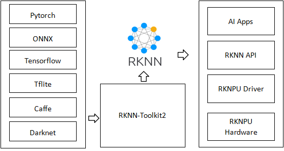
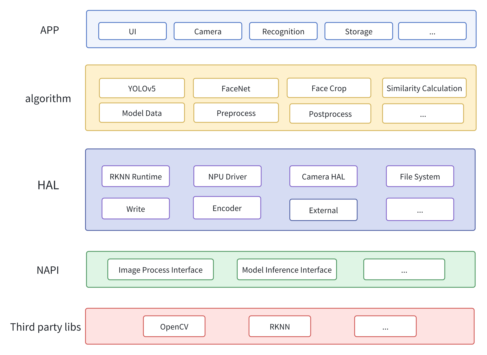
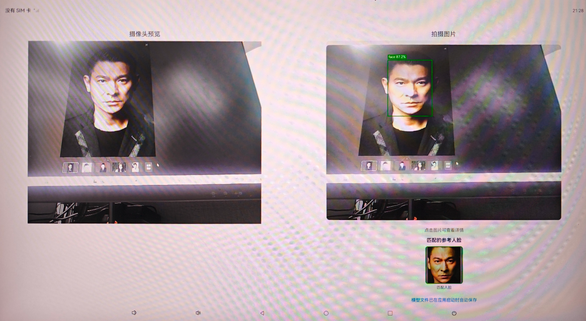
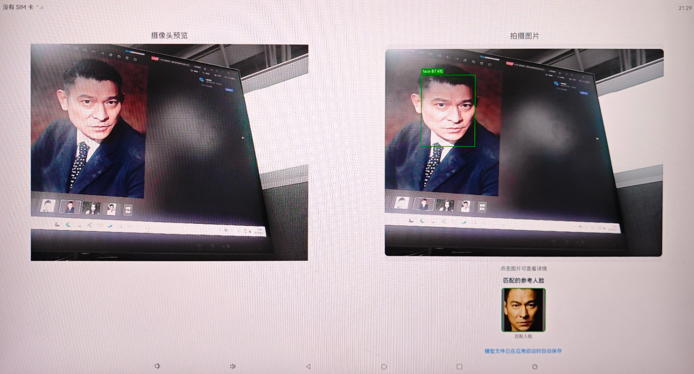
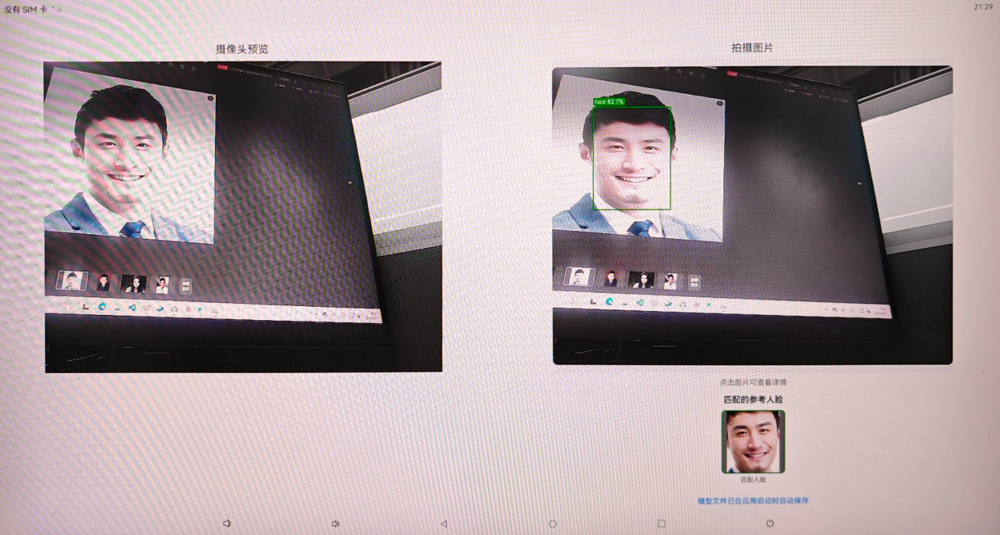
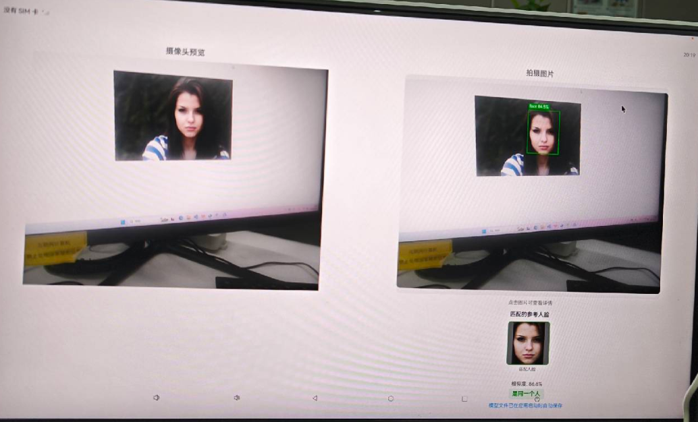

# Rknn Faical Recognition Demo

## RKNN介绍

  RKNN 是 Rockchip npu 平台使用的模型类型，以.rknn后缀结尾的模型文件。Rockchip 提供了完整了模型转换 Python 工具，方便用户将自主研发的算法模型转换成 RKNN 模型。



  为了使用 RKNPU ，用户需要先在电脑上运行 RKNN-Toolkit2 工具，将训练好的模型转换为 RKNN 格式的模型。

## 示例原理框图

  本示例的原理框图如下：



## 该示例支持平台

- RK3588 系列
- 案例提供模型
  RK3588 系列版本的 yolov5.rknn 和 facenet.rknn
- **备注：支持搭载 Rockchip NPU 的设备（例如RK3588,RK3568），但本案例只提供 RK3588 的 rknn 模型，如需支持其他芯片需开发者自行添加相应芯片的 rknn 模型。**

## 该示例演示板卡

- 视美泰 AIoT-3588A

## 切换模型须知

- 因本案例 RK3568 系列仅提供 yolov5.rknn，所以**开发者如需测试 RK3568 人脸检测功能，则需要对源码进行一定修改，注释掉人脸识别部分的代码，详细注释代码请看Change_model_RK3568.md**


## 添加人脸与模型

- 参考人脸添加到 src/main/resources/rawfile/face_databases，按照 1-20 命名图片名字，图片后缀为.jpg
- 如果需要兼容其他 Rockchip 芯片，可以在 src/main/resources/rawfile/model/usemodel 添加兼容的模型替换掉原有模型，该示例出厂 usemodel 目录下存放的是 RK3588 系列版本兼容的模型。

## 效果预览

本示例实现了基于RKNN的人脸检测与识别功能，支持实时相机预览、人脸检测框绘制、人脸特征提取与比对等功能。

### 使用说明

1. 启动应用后，相机会自动开始预览
2. 当检测到人脸时，会在人脸周围绘制检测框
3. 可以通过界面按钮切换人脸识别模式（特征录入模式/识别模式）
4. 在特征录入模式下，系统会自动提取并保存人脸特征
5. 在识别模式下，系统会将检测到的人脸与已保存的特征进行比对

## 工程目录

```
entry/src/main/
|---cpp
|   |---include
|   |   |---model.h                           // 模型推理接口定义
|   |   |---preprocess.h                      // 图像预处理接口
|   |   |---postprocess.h                     // 后处理接口
|   |   |---face_crop_utils.h                 // 人脸裁切工具
|   |   |---Common.hpp                        // 通用定义
|   |---facial_recognition.cpp                // 主要的人脸识别实现
|   |---model.cpp                             // 模型加载与推理实现
|   |---postprocess.cc                        // YOLOv5后处理实现
|   |---face_crop_utils.cpp                   // 人脸裁切工具实现
|   |---face_preprocess_utils.cpp             // 人脸预处理工具实现
|   |---CMakeLists.txt                        // 编译脚本
|   |---types
|   |   |---libentry
|   |   |   |---index.d.ts                    // TypeScript接口定义
|---ets
|   |---entryability
|   |   |---EntryAbility.ets                  // 应用入口
|   |---pages
|   |   |---Index.ets                         // 主页面
|---resources
|   |---rawfile                               // 原始资源文件
|   |   |---face_databases                    // 存放人脸识别时的参考人脸图片目录
|   |   |   |---1.jpg
|   |   |   |---2.jpg
|   |   |   |---3.jpg
|   |   |---model                         
|   |   |   |---usemodel
|   |   |   |   |---yolov5.rknn              // YOLOv5人脸检测模型
|   |   |   |   |---facenet.rknn             // FaceNet人脸特征提取模型
|---libs
|   |---arm64-v8a
|   |   |---librknnrt.so                      // RKNN运行时库
|   |   |---libopencv_core.so                 // OpenCV核心库
|   |   |---libopencv_imgcodecs.so            // OpenCV图像编解码库
|   |   |---libopencv_imgproc.so              // OpenCV图像处理库
```

## 具体实现

### 模型加载与初始化

* 本示例使用两个RKNN模型：

  - **yolov5.rknn**: 用于人脸检测，基于YOLOv5架构训练
  - **facenet.rknn**: 用于人脸特征提取，基于FaceNet架构训练
* 模型加载流程：

  1. 首先尝试从应用沙箱目录加载已保存的模型文件
  2. 如果沙箱中不存在，则从rawfile资源中加载
  3. 初始化RKNN上下文，设置使用所有NPU核心（RKNN_NPU_CORE_0_1_2）
  4. 查询模型的输入输出信息，获取tensor属性

### 图像预处理

* **Letterbox处理**: 保持图像宽高比的同时调整到模型输入尺寸
* **归一化**: 将像素值归一化到[0,1]范围
* **格式转换**: 将图像从BGR格式转换为RGB格式

### 人脸检测与识别流程

1. **人脸检测**:

   - 使用YOLOv5模型检测图像中的人脸
   - 应用NMS（非极大值抑制）去除重复检测框
   - 绘制检测框到原图像上
2. **人脸裁切**:

   - 根据检测结果裁切人脸区域
   - 保存裁切后的人脸图像到沙箱目录
3. **特征提取**:

   - 使用FaceNet模型提取人脸特征向量
   - 特征向量维度为512维
4. **人脸识别**:

   - 计算当前人脸特征与已保存特征的余弦相似度
   - 设置相似度阈值判断是否为同一人

### 异步处理机制

* 实现了异步人脸识别工作线程，避免阻塞主线程
* 使用任务队列管理人脸识别任务
* 支持实时获取识别结果

### 核心API接口

| 接口名                          | 描述                                   |
| :------------------------------ | :------------------------------------- |
| ProcessImageWithRKNN            | 主要的图像处理接口，执行人脸检测和识别 |
| SaveModelFile                   | 保存模型文件到沙箱目录                 |
| StartFaceRecognitionWorker      | 启动异步人脸识别工作线程               |
| StopFaceRecognitionWorker       | 停止异步人脸识别工作线程               |
| AddFaceRecognitionTask          | 添加人脸识别任务到队列                 |
| GetLatestFaceRecognitionResult  | 获取最新的人脸识别结果                 |
| SetFaceRecognitionMode          | 设置人脸识别模式（录入/识别）          |
| AddReferenceFaceFeature         | 添加参考人脸特征                       |
| ClearReferenceFaceFeatures      | 清空参考人脸特征                       |
| CleanupAllFacePreprocessedFiles | 清理临时人脸文件                       |

## 技术特点

### 高性能

- **NPU加速**: 充分利用Rockchip NPU的算力，实现高效的模型推理
- **多核心支持**: 设置使用所有三个NPU核心，最大化硬件利用率
- **异步处理**: 人脸识别采用异步处理，不阻塞UI线程
- **内存优化**: 智能管理模型数据和图像缓存，避免内存泄漏

### 易用性

- **自动模型管理**: 支持从资源文件自动加载模型到沙箱目录
- **灵活的识别模式**: 支持特征录入模式和识别模式切换
- **实时结果反馈**: 提供实时的人脸检测和识别结果
- **文件自动清理**: 自动清理临时生成的人脸图像文件

## 相关权限

本示例需要以下权限：

- **相机权限**: 用于获取相机预览数据
- **存储权限**: 用于保存和读取模型文件、人脸图像等

## 依赖

### 系统依赖

- **OpenHarmony**: 支持OpenHarmony 5.0.0 (API 12)
- **设备要求**: 需要支持Rockchip NPU的设备

### 第三方库依赖

- **RKNN Runtime**: Rockchip NPU运行时库
- **OpenCV**: 用于图像处理和计算机视觉操作
  - libopencv_core.so: OpenCV核心功能
  - libopencv_imgcodecs.so: 图像编解码
  - libopencv_imgproc.so: 图像处理

### 模型依赖

将所需模型放置在rawfile/model/usemodel/目录下 
- **yolov5.rknn**: 人脸检测模型，需要放置在rawfile/model/usemodel/目录下
- **facenet.rknn**: 人脸特征提取模型，需要放置在rawfile/model/usemodel/目录下

### 人脸识别人脸库依赖

将所需识别人物的参考人脸图片放置在rawfile/face_databases目录下  
按 1-20 命名，例如：1.jpg

## 编译与运行

### 编译要求

- **DevEco Studio**: 5.0.0
- **OpenHarmony SDK**: API 12

### 编译步骤

1. 使用DevEco Studio打开项目
2. 确保所有依赖库已正确配置
3. 检查模型文件是否已放置在正确位置
4. 点击Build按钮进行编译
5. 连接支持的设备进行调试运行

### 注意事项

- 首次运行时需要等待模型文件从rawfile复制到沙箱目录
- 确保设备有足够的存储空间用于保存临时文件
- 建议在光线充足的环境下进行人脸识别以获得更好的效果

## 应用运行效果图

在视美泰 AIoT-3588A 板卡中，应用运行效果如下：








## 演示板卡获取地址：

| 板卡型号 | 板卡链接 |
| --- | --- |
| 视美泰 AIoT-3588A | https://www.shimeta.com.cn/productinfo/2825609.html |

## 约束与限制

1. **硬件限制**:

   - 仅支持搭载Rockchip NPU的设备（RK3588系列、RK3568系列）
   - 需要足够的内存支持模型加载和推理
2. **系统要求**:

   - 支持 OpenHarmony 5.0.0
   - 需要相机硬件支持
3. **性能限制**:

   - 人脸检测性能取决于NPU算力和图像分辨率
   - 同时处理的人脸数量建议不超过10个
4. **模型限制**:

   - 模型文件大小限制在100MB以内
   - 输入图像分辨率建议在640x640以内以获得最佳性能
5. **开发环境**:

   - 需要使用DevEco Studio 5.0及以上版本进行开发
   - 需要配置相应的SDK

## 致谢

本项目参考和使用了以下开源项目和技术：

- **Rockchip RKNN**: 提供NPU推理框架支持
- **OpenCV**: 提供图像处理功能
- **YOLOv5**: 人脸检测算法基础
- **FaceNet**: 人脸特征提取算法基础
- **OpenHarmony**: 提供应用开发平台

感谢所有为这些项目做出贡献的开发者们。

## 本地构建与签名

`build-profile.json5` 包含本机 SDK 和签名配置，因此不会提交到 Git。首次拉取代码后，请复制 `build-profile.example.json5` 为 `build-profile.json5`，再通过 DevEco Studio 配置本机 OpenHarmony SDK 与自动签名。
